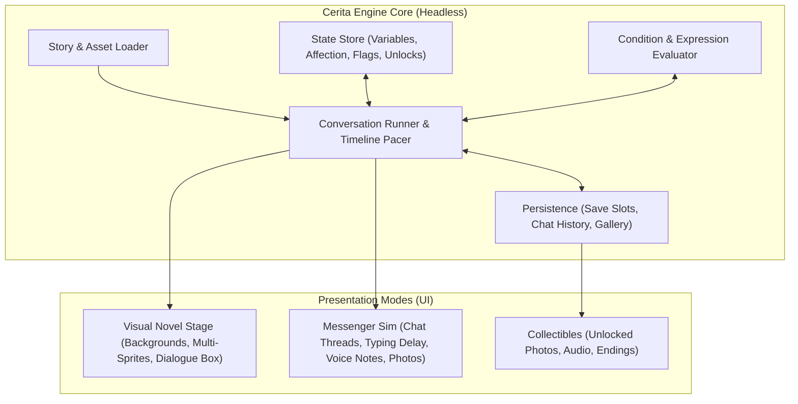

# Cerita Engine (`fsse`) Specifications

**Cerita Engine** (packaged as `fsse` — *Flutter Simple Story Engine*) is a JSON-driven interactive narrative engine built with Flutter. It is designed to power both **modern Visual Novels (VN)** and **chat-based messaging simulations** (inspired by games like *Salah Sambung 3* by Rolling Glory Jam), or hybrid stories that transition between both formats.

## Vision & Core Pillars

1. **Mode-Agnostic Narrative Core**: A headless engine (`FsseEngine`) that processes story scripts, evaluates conditions, mutates relationship/story state, and emits structured dialogue items without coupling to a specific UI layout.
2. **Dual Presentation Modes**:
   - **Messenger / Chat Sim Mode**: Emulates a real-world messaging app with 1-on-1 and group threads, typing indicators, voice notes, photo/video attachments, and real-time or day-based pacing.
   - **Visual Novel (VN) Stage Mode**: Full-screen backgrounds, multi-slot character sprites with expressions and transitions, dialogue boxes, voice-over/SFX, and full-screen event CGs.
3. **Choice & Consequence**: Typed state variables (strings, numbers for affection/karma, booleans for story flags), conditional choices, timed dilemmas, and branching routes leading to multiple endings.
4. **Replayability & Collectibles**: Built-in cross-playthrough tracking for unlocked photos, CGs, voice notes, videos, and endings, paired with chapter/day checkpoints so players can explore every route.

## Architecture Overview

## Specification Index

- **[Data & JSON Schemas](./data-schema.md)**: Directory conventions, `profiles.json`, conversation files (`index.json`, `cvn_<id>.json`), `scene` configuration, and all `ItemType` schemas.
- **[Engine, State & Persistence](./engine-and-state.md)**: `FsseEngine` contract, typed state store, `effects` and `condition` evaluation, variable interpolation, save slots, checkpoints, and global gallery unlocks.
- **[Presentation Modes](./presentation-modes.md)**: UI/UX specifications for Messenger/Chat Mode, Visual Novel Stage Mode, audio lifecycle, and collectible Gallery/Endings screens.
