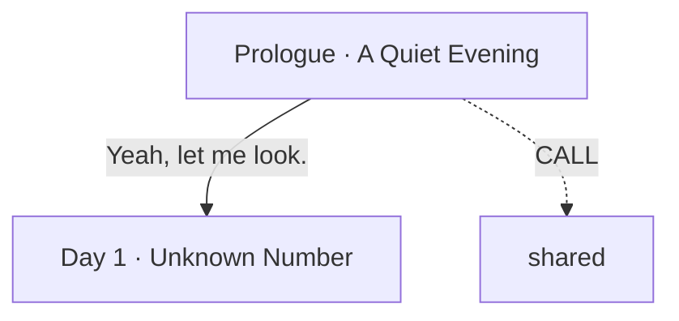

| Bad credits | `credits.json` fails to load (a section without `title`, a person without `name`, an asset without `title`, `author`, `source` or `license`), or `roll_after` names an `ending_id` no `ENDING` has. |
# Authoring Tools Specification

Tools for writers working on a story: a linter that finds mistakes before a player does, a graph of how the story flows, and a developer panel inside the running story.

These tools work on story JSON. Stories written as `.cerita` scripts go through the [story authoring toolkit](authoring-toolkit.md) (`cerita_tools`), which compiles them and runs this linter on the result, reporting each issue at its script line.

---

## 1. Story Linter (`StoryLinter`)

Reads every conversation through an `EngineLoader` and reports issues. Pure Dart, so it runs in the CLI (§3), in tests and in the developer panel (§4).

Each issue has a severity, the conversation file, the item index (when it belongs to an item), the part of the item
it's about (when it names one: `choices[2]`, `branches[0]`, `fallback_target`, `effects[1]`, `actions[0]`, or nested
like `choices[2].effects[0]`) and a message:

```text
error   cvn_day2.json #14 choices[1].target  Target 'ending_tru' doesn't exist
warning index.json #9      Variable 'curiousity' is read but never set
```

### 1.1 Errors
The story breaks or behaves wrongly when it gets there.

| Check | Example |
| :--- | :--- |
| A file fails to load | Bad JSON, an unknown item `type`, an unknown `STAGE` action or transition. |
| A `target` points nowhere | `"day3"` without `cvn_day3.json`, `"#hub"` without an item with `"id": "hub"`. Covers `CHOICE`, `BRANCH` (and `fallback_target`), `JUMP` and `CALL`. |
| Unknown character | `profile` / `show` with an id missing from `profiles.json`. |
| Missing sprite | `"123aaa:5"` when the profile has 3 sprites. |
| Bad expression | A `condition`, branch condition or effect `expr` that doesn't parse, or calls an unknown function. |
| Duplicate label | Two items with the same `id` in one conversation. |
| Empty choice | A `CHOICE` without options, or a `default_choice` that isn't one of them. |
| Chat without a thread | A `CHAT` scene without `channel_id`. |
| Missing file | A background, sprite, avatar, music, ambience, sound, voice, media or clue image file that isn't there. Only checked when the linter is told which files exist. A voice clip or voice note passes with its shared file (`vo.mp3`) or with one for every story locale (`vo.id.mp3`, `vo.en.mp3`), the files the player tries (data schema §7.4). |
| Bad `clues.json` | A clue without `id` or `title`, an `id` that isn't `[a-zA-Z0-9_]+`, or two clues with the same `id`. |
| Undeclared clue | A `clue_<x>` variable read or set, or an evidence response for clue `x`, when `x` isn't in `clues.json`. The `clue_` variables are only checked in stories that have a `clues.json`. |
| Bad evidence question | No `responses`, two responses for one clue, `choices` or `default_choice` on it, or negative `retries`. |
| Evidence question without an answer | No clue with a response is awarded before the question can be reached (see below). |
| Bad credits | `credits.json` doesn't load (a section without `title`, a person without `name`, an asset without `title`, `author`, `source` or `license`), or its `roll_after` names an `ending_id` no `ENDING` has. |

### 1.2 Warnings
Probably a mistake, but the story still runs.

| Check | Example |
| :--- | :--- |
| Unknown text tag | `{shaek}` is shown as written. An escaped `{{b}` is not reported. |
| Variable read but never set | A condition, `expr` or `{{VAR}}` uses a variable that no effect, `CHOICE` or `INPUT` sets. Usually a typo. |
| Variable set but never read | Nothing reads it, so it has no effect. |
| Unreachable conversation | No `target` from `index.json` leads to it, directly or through other conversations. |
| Dead items | Items right after a `JUMP` or `RETURN` without a condition, that no label leads to. |
| Unknown chat thread | A `channel_id` that `channels.json` doesn't list (when the file exists). |
| Clue never awarded | A clue in `clues.json` that no effect sets. Clue variables are not reported as "set but never read": the board reads them. |
| Story stops | A conversation entered by a target (or `index`) can run out of items with no `ENDING`, `JUMP`, `RETURN` or `BRANCH` fallback after its last entry point (its start, or a label a target uses). The engine then ends the story without an ending. Reported at the last item. Conversations only reached through `CALL` return to their caller instead and aren't checked. A `CHOICE` leads on when every option has a target and one of them has no condition and isn't `once`. An evidence question (`"source": "clues"`) leads on when every response and its `fallback` (and `timeout`, if given) have a target. Conditions aren't evaluated. |
| Reply sent twice | In a `CHAT` scene, the first item the player sees after an option that isn't `silent` is a player `TEXT` line in the same thread. The option is sent as the player's message and then the scripted line repeats it. Warning, reported at the option. See §1.4 for how the linter follows the story after the pick. |

### 1.3 Clues awardable before an evidence question

An evidence question needs at least one clue with a response on the board when it is asked (PRD CE-06). The
linter checks it per question with the story graph (§2), approximating "before" as:

- an award earlier in the same conversation (a lower item index, in item or choice effects), or
- an award in any conversation that can reach the question's conversation through targets, in a
  conversation those `CALL`, or in one the question's conversation `CALL`s before the question.

It doesn't follow conditions, so a clue awarded on another branch of the same day still counts. A full
path check needs the automated playthroughs of the story authoring toolkit (CE-02).

### 1.4 What plays after a chat option

For "Reply sent twice" the linter plays the story forward from each option that isn't `silent`, without a
player:

- **What it knows.** The pick stores the option's `value` in the `CHOICE` variable (its text when it has no
  `value`), then runs the option's effects. These are the only values it knows. Effects that need anything
  else, and `random()`, make their variable unknown.
- **Conditions.** An item whose condition is false with these values is skipped, like the engine skips it. A
  condition that reads an unknown variable might go either way, so the linter stops there and reports nothing.
  A player line that only might play isn't reported.
- **Items nobody sees.** `SET`, `STAGE` and `WAIT` are walked past, with their effects. A `WAIT` notification
  isn't a chat message, so it doesn't count either.
- **Targets.** It follows the option's target, `JUMP`, `CALL`, `RETURN` and `BRANCH` (when its conditions
  are known), to `#label`, `conv` or `conv#label`. A conversation with another scene or chat thread stops the
  walk: the line isn't next to the reply there.
- **The first item the player sees** decides it: a player `TEXT` is reported, anything else isn't.

A conversation without a `scene` keeps the one it is entered from. It is checked as a chat when every
conversation whose targets lead to it plays in the same chat thread. A conversation entered from different
scenes, or from nowhere, isn't checked. Coming back from a `CALL` isn't followed for this.

---

## 2. Story Graph (`StoryGraph`)

The conversations and the `target`s between them, built from the same files. `toMermaid()` renders a [Mermaid](https://mermaid.js.org) flowchart: one node per conversation (labelled with its chapter and title, endings marked), one edge per target labelled with the choice text or branch condition. `CALL` edges are dashed.



### 2.1 Route Map (`RouteMap`)

The chapter-level view of the same graph, for the Chapters flowchart (presentation modes §4, CE-07).
`RouteMap(graph)` keeps only checkpoints and endings:

- **Nodes**: every conversation with `"checkpoint": true`, and every `ending_id`. A conversation that isn't a
  checkpoint (a call scene, a shared subroutine, an ending scene) is folded into the checkpoint that leads to it.
- **Edges**: a checkpoint leads to the checkpoints and endings it can reach through targets of any kind without
  passing another checkpoint. Conditions aren't evaluated, so every possible branch is drawn.
- **Roots**: `index` when it's a checkpoint, else the first checkpoints and endings reachable from it.
  Checkpoints no route reaches are left out (the linter warns about them).
- **Layers**: each node sits one row below the lowest node leading to it. Edges that go back to an earlier node
  (a route that loops) are kept for reachability but not drawn. Within a row, nodes follow the order of the nodes
  above them, then story order.
- `endingsAfter(node)` is every ending reachable from a node, for "1 of 3 endings found". `branches` tells whether
  any node leads to two or more nodes.

---

## 3. Command Line

`cerita_core` ships a `cerita` command that reads a story folder from disk:

```bash
dart run cerita_core:cerita lint example/assets/story
dart run cerita_core:cerita graph example/assets/story > story.mmd
```

- The story folder holds `index.json`, `profiles.json`, `channels.json`, the `cvn_*.json` files and the `bg/`, `sprites/`, `music/` and `media/` folders (data schema §1), so missing files are checked too.
- `lint` prints the issues and exits with `1` when there are errors, so CI can run it. `--strict` also fails on warnings.
- `make lint-story` lints the demo story.
- For a story written as scripts, use `dart run cerita_tools lint <story>` instead. It runs the same linter on the compiled story plus the script checks ([authoring toolkit §3.1](authoring-toolkit.md#31-lint)).

---

## 4. Developer Panel

Opened from the in-game menu when `StorySetup.developer` is true (the demo turns it on in debug builds) or the player setting `developer_tools` is on (§5, engine and state §5). Never shown to players otherwise.

- **Variables**: every playthrough and `persistent.*` variable with its value. Values can be edited or added (numbers, `true` / `false`, or text), and take effect right away. Remembered facts (`meta.flag.*`) are listed too, read-only, since only the `meta_set` effect can remember one.
- **Jump**: every conversation and its labels. Picking one continues the story there, keeping the variables.
- **Check**: runs the linter (§1) on the bundled story, including missing assets.
- **Reload story**: reads the story files again and continues at the same conversation and item. A Flutter hot reload (`r` in `flutter run`) does it automatically, so edits to the JSON show up without restarting the story. If items were added or removed above the current one, the story continues at the same position, which may be another item.

## 5. Admin Tools

For testers and reviewers on a release build, where the developer panel is off. A story opens them through
`AdminGate`, which wraps any widget and shows the `AdminSheet` after seven quick taps on it (each within 600 ms of
the last, like the build number tap behind Android's developer options). Nothing on screen says it is there. Last
Seen puts the gate on the title screen's logo.

- **Unlock everything** (`StoryUnlocker.unlockAll`): every gallery item (`MEDIA` with an `unlock_id`), every ending
  and every music track is added to the meta-state, and every checkpoint to the chapter list. Progress already
  there stays, including a chapter's own snapshot.
- **Chapters** need the variables of a real playthrough, or the story after them misses its clues and flags. So
  the unlocker plays the story headlessly, once per policy, and keeps the first snapshot each run takes at each
  checkpoint:

  | Policy | Choices | Evidence |
  | :--- | :--- | :--- |
  | `defaults` | A timed choice's timeout option, else the first | The first response |
  | `defaultsLast` | A timed choice's timeout option, else the last | The last response |
  | `first` | The first option | The first response |
  | `last` | The last option | The last response |

  Inputs get their `default_value`, or nothing, so a puzzle goes through its wrong answers until its own hints
  solve it. A run stops at an ending or after 5,000 items. A chapter no run reaches is unlocked with no variables
  and named in the report. The runs keep a meta-state of their own, so what they read, choose or remember never
  reaches the player's: read-skip, choice marks and `meta.flag.*` stay as the player left them.
- **Developer tools**: a switch for the `developer_tools` player setting, which adds the developer panel (§4) to
  the in-game menu in any build. It persists like the other settings.

There is no "lock again". Unlocking is meant for test devices, whose progress can be cleared with the app data.
