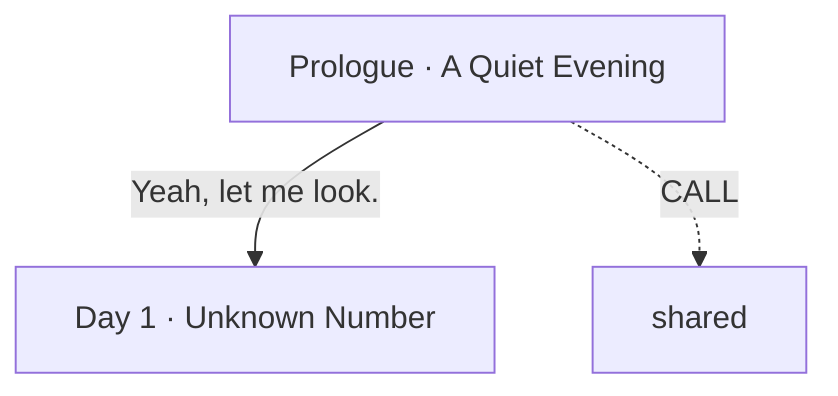

# Authoring Tools Specification

Tools for writers working on a story: a linter that finds mistakes before a player does, a graph of how the story flows, and a developer panel inside the running story.

These tools work on story JSON. Stories written as `.cerita` scripts go through the [story authoring toolkit](authoring-toolkit.md) (`cerita_tools`), which compiles them and runs this linter on the result, reporting each issue at its script line.

---

## 1. Story Linter (`StoryLinter`)

Reads every conversation through an `EngineLoader` and reports issues. Pure Dart, so it runs in the CLI (§3), in tests and in the developer panel (§4).

Each issue has a severity, the conversation file, the item index (when it belongs to an item) and a message:

```text
error   cvn_day2.json #14  Target 'ending_tru' doesn't exist
warning index.json #9      Variable 'curiousity' is read but never set
```

### 1.1 Errors
The story breaks or behaves wrongly when it gets there.

| Check | Example |
| :--- | :--- |
| A file fails to load | Bad JSON, an unknown item `type`, an unknown `STAGE` action or transition. |
| A `target` points nowhere | `"day3"` without `cvn_day3.json`, `"#hub"` without an item with `"id": "hub"`. Covers `CHOICE`, `BRANCH` (and `fallback_target`), `JUMP` and `CALL`. |
| Unknown character | `profile` / `show` with an id missing from `profiles.json`. |
| Missing sprite | `"123aaa:5"` when the profile has 3 sprites. |
| Bad expression | A `condition`, branch condition or effect `expr` that doesn't parse, or calls an unknown function. |
| Duplicate label | Two items with the same `id` in one conversation. |
| Empty choice | A `CHOICE` without options, or a `default_choice` that isn't one of them. |
| Chat without a thread | A `CHAT` scene without `channel_id`. |
| Missing file | A background, sprite, avatar, music, ambience, sound, voice, media or clue image file that isn't there. Only checked when the linter is told which files exist. |
| Bad `clues.json` | A clue without `id` or `title`, an `id` that isn't `[a-zA-Z0-9_]+`, or two clues with the same `id`. |
| Undeclared clue | A `clue_<x>` variable read or set, or an evidence response for clue `x`, when `x` isn't in `clues.json`. The `clue_` variables are only checked in stories that have a `clues.json`. |
| Bad evidence question | No `responses`, two responses for one clue, `choices` or `default_choice` on it, or negative `retries`. |
| Evidence question without an answer | No clue with a response is awarded before the question can be reached (see below). |

### 1.2 Warnings
Probably a mistake, but the story still runs.

| Check | Example |
| :--- | :--- |
| Unknown text tag | `{shaek}` is shown as written. An escaped `{{b}` is not reported. |
| Variable read but never set | A condition, `expr` or `{{VAR}}` uses a variable that no effect, `CHOICE` or `INPUT` sets. Usually a typo. |
| Variable set but never read | Nothing reads it, so it has no effect. |
| Unreachable conversation | No `target` from `index.json` leads to it, directly or through other conversations. |
| Dead items | Items right after a `JUMP` or `RETURN` without a condition, that no label leads to. |
| Unknown chat thread | A `channel_id` that `channels.json` doesn't list (when the file exists). |
| Clue never awarded | A clue in `clues.json` that no effect sets. Clue variables are not reported as "set but never read": the board reads them. |

### 1.3 Clues awardable before an evidence question

An evidence question needs at least one clue with a response on the board when it is asked (PRD CE-06). The
linter checks it per question with the story graph (§2), approximating "before" as:

- an award earlier in the same conversation (a lower item index, in item or choice effects), or
- an award in any conversation that can reach the question's conversation through targets, in a
  conversation those `CALL`, or in one the question's conversation `CALL`s before the question.

It doesn't follow conditions, so a clue awarded on another branch of the same day still counts. A full
path check needs the automated playthroughs of the story authoring toolkit (CE-02).

---

## 2. Story Graph (`StoryGraph`)

The conversations and the `target`s between them, built from the same files. `toMermaid()` renders a [Mermaid](https://mermaid.js.org) flowchart: one node per conversation (labelled with its chapter and title, endings marked), one edge per target labelled with the choice text or branch condition. `CALL` edges are dashed.



---

## 3. Command Line

`cerita_core` ships a `cerita` command that reads a story folder from disk:

```bash
dart run cerita_core:cerita lint example/assets/story
dart run cerita_core:cerita graph example/assets/story > story.mmd
```

- The story folder holds `index.json`, `profiles.json`, `channels.json`, the `cvn_*.json` files and the `bg/`, `sprites/`, `music/` and `media/` folders (data schema §1), so missing files are checked too.
- `lint` prints the issues and exits with `1` when there are errors, so CI can run it. `--strict` also fails on warnings.
- `make lint-story` lints the demo story.
- For a story written as scripts, use `dart run cerita_tools lint <story>` instead. It runs the same linter on the compiled story plus the script checks ([authoring toolkit §3.1](authoring-toolkit.md#31-lint)).

---

## 4. Developer Panel

Opened from the in-game menu when `StorySetup.developer` is true (the demo turns it on in debug builds). Never shown to players otherwise.

- **Variables**: every playthrough and `persistent.*` variable with its value. Values can be edited or added (numbers, `true` / `false`, or text), and take effect right away.
- **Jump**: every conversation and its labels. Picking one continues the story there, keeping the variables.
- **Check**: runs the linter (§1) on the bundled story, including missing assets.
- **Reload story**: reads the story files again and continues at the same conversation and item. A Flutter hot reload (`r` in `flutter run`) does it automatically, so edits to the JSON show up without restarting the story. If items were added or removed above the current one, the story continues at the same position, which may be another item.
