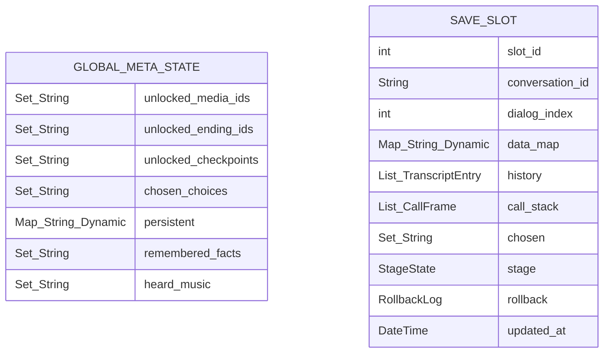

# Engine, State & Persistence Specification

This document specifies how `FsseEngine` manages runtime state, evaluates conditions and effects, interpolates variables, and persists progress across sessions.

---

## 1. Engine Contract (`FsseEngine`)

```dart
abstract class FsseEngine {
  /// Advance to the next eligible item, optionally applying [prevResult]
  /// from an INPUT or CHOICE item.
  Future<ItemType> next({ItemResult? prevResult});

  /// Return the current active item without advancing the index.
  Future<ItemType> get();

  /// Read the current playthrough's variable and stats store.
  Map<String, dynamic> getDataMap();

  /// Resolve the character Profile for a given [itemType].
  Profile? getProfile(ItemType itemType);
}
```

### Execution Lifecycle
1. **Initial Load**:
   - On the first call to `get()` or `next()`, the engine calls `EngineLoader.initialLoad()` to parse `profiles.json` and `index.json`.
   - Emits `EngineListener.onNewScene(conversation.scene)`.
2. **Result Handling (`_handleResult`)**:
   - When `next(prevResult: ...)` is called:
     - If `prevResult.variable` is non-null, writes `dataMap[prevResult.variable!] = prevResult.value`.
     - If `prevResult.effects` is non-empty, applies each state mutation in order.
     - If `prevResult.target` is non-null, loads `cvn_<target>.json` via `EngineLoader.loadConversation(target)`, resets `dialogIndex = 0`, and notifies `EngineListener.onNewScene`.
3. **Item Resolution & Condition Filtering**:
   - At `dialogIndex`, if the item defines a `condition` that evaluates to `false`, the engine automatically increments `dialogIndex` and evaluates the next item.
   - If the item is a `BRANCH` item, the engine evaluates `branches` in order, loads the matching `target` (or `fallback_target`), and resolves the first item of that new conversation.
   - `JUMP`, `CALL`, `RETURN` and `SET` are resolved silently the same way: their `effects` are applied and the engine moves on. Running out of items inside a `CALL` returns to the caller; running out with an empty call stack ends the story.
   - A `STAGE` item updates the saved stage state (§6) and is returned to the UI so it can animate it. It is not recorded in the transcript.
   - Applies any item-level `effects`, clones the item with interpolated variables (`cloneWithData`), records the item in the active transcript history, and increments `dialogIndex`.

---

## 2. Typed State Store & Effects

The state store (`dataMap`) holds `Map<String, dynamic>` supporting `String`, `num` (`int`/`double`), and `bool` values.

### State Mutation (`Effect`)
Effects allow choices and dialogue items to modify relationship scores, counters, and flags:

| `op` | Target Type | Behavior |
| :--- | :--- | :--- |
| `"set"` | `String` \| `num` \| `bool` | Sets `dataMap[variable] = value`. |
| `"add"` | `num` | Adds `value` to `dataMap[variable]` (initializes to `0` if unset). |
| `"subtract"` | `num` | Subtracts `value` from `dataMap[variable]` (initializes to `0` if unset). |
| `"toggle"` | `bool` | Flips boolean value of `dataMap[variable]` (initializes to `false` if unset). |
| `"meta_set"` | — | Remembers the fact `variable` across playthroughs. Writes to the global meta-state, not `dataMap`. `value` is ignored. See *Cross-Playthrough Memory*. |

Any effect can take an `expr` instead of a `value`. The expression is evaluated (§3) when the effect runs and its result is used as the value:

```json
{ "variable": "score", "op": "set", "expr": "(miki_trust + luna_affection) * 2" }
{ "variable": "dice", "op": "set", "expr": "random(1, 6)" }
```

### Persistent Variables
Variables named `persistent.<name>` live in the global meta-state instead of the playthrough. They survive new games and save loads, so they can count runs or unlock extra routes after an ending:

```json
{ "variable": "persistent.seen_true_end", "op": "set", "value": true }
```

### Cross-Playthrough Memory
*Backlog CE-03.* A story can remember named facts across playthroughs and read them, together with the endings
ever reached, from any condition. This is how a true ending can need clues from routes no single run visits.

**Remembering.** The `meta_set` effect op remembers a fact. It works anywhere effects do: item `effects`
(including `SET`), and choice `effects`.

```json
{ "variable": "knows_boat_name", "op": "meta_set" }
```

- Facts are names, not values: a fact is either remembered or not. A remembered fact can't be forgotten
  except by Reset progress.
- Facts live in the global meta-state (`remembered_facts`, §5.1), not in `dataMap`, so they aren't part of
  save slots, checkpoints or rollback frames. They survive New game, loading any save and replaying from a
  checkpoint. Loading an older save doesn't roll them back, and rolling back past a `meta_set` doesn't
  forget the fact.
- The meta-state is saved as soon as the item or choice that remembered a fact has run.
- Endings are remembered automatically when an `ENDING` item is reached (`unlocked_ending_ids`), as before.

**Reading.** Expressions see two read-only namespaces through `StoryState`:

| Variable | Value |
| :--- | :--- |
| `meta.ending.<ending_id>` | `true` if an `ENDING` with that `ending_id` was ever reached, else `false` |
| `meta.flag.<name>` | `true` if the fact `<name>` was ever remembered with `meta_set`, else `false` |

They are always booleans, never unset, and combine with run variables using the usual operators:

```json
{ "condition": "meta.ending.end_storm && found_boat_name" }
{ "condition": "meta.flag.knows_boat_name && meta.flag.knows_podcast_host" }
{ "condition": "!meta.ending.end_storm" }
```

- Writing to a `meta.*` variable with `set`, `add`, `subtract`, `toggle` or an `INPUT` throws. Use `meta_set`.
- Any other `meta.<namespace>.<name>` is an error when read. Plain variables named `meta` or `metadata` are
  unaffected: only names starting with `meta.` are reserved.
- Ending ids and fact names used here must match `[a-zA-Z0-9_]+` so the expression tokenizer reads them as one
  name.
- `meta.*` vs `persistent.*`: `persistent.*` holds any value and any op can change it, for counters and
  author-managed state. `meta.flag.*` is the write-once fact list the PRD asks for, kept apart so a fact
  can't be overwritten or decremented by mistake.

**Hiding memory-gated choices.** A choice whose `condition` reads a `meta.*` variable and evaluates to
`false` is left out of the menu instead of being shown locked. A first playthrough then looks exactly as it
would without the feature, and a past-run reward isn't spoiled by a lock. Choices gated only on run
variables keep the locked look.

**Marking unlocked choices.** A choice can set `"memory_marker": true` (data-schema §4.4). While the choice is
available, the UI shows a small marker on it so the player notices what past runs unlocked. The author
decides per choice, since marking every unlock would spoil some secrets. The default `StorySkin` draws a
sparkle icon through `StorySkin.memoryMarker`, which skins override to restyle it, or return `null` to hide it.

---

## 3. Condition Evaluator

Conditions are boolean expressions evaluated against `dataMap`. The same evaluator computes effect `expr` values.
- **Comparison operators**: `==`, `!=`, `>`, `>=`, `<`, `<=`
- **Logical operators**: `&&`, `||`, `!`
- **Arithmetic**: `+`, `-`, `*`, `/`, `%`, unary `-`, parentheses. `+` joins strings when either side is a string.
- **Functions**: `random(min, max)` (inclusive integer), `min(a, b)`, `max(a, b)`, `abs(x)`, `floor(x)`, `ceil(x)`, `round(x)`
- **Variables**: `[a-zA-Z_][a-zA-Z0-9_.]*`, so `persistent.runs` works.
- **Memory**: `meta.ending.<ending_id>` and `meta.flag.<name>` read cross-playthrough memory, see §2 *Cross-Playthrough Memory*.
- **Missing variables**: Unset numeric variables default to `0` in numeric comparisons; unset booleans default to `false`.

Examples:
- `"affection_luna >= 10"`
- `"miki_trust > 0 && saw_secret_photo == true"`
- `"PILL == 'Blue'"`

---

## 4. Variable Interpolation (`VariableReplacer`)

Any user-facing text field (`text`, `caption`, choice `text`, choice `value`) supports `{{VARIABLE_NAME}}` placeholders via `VariableReplacer`:
- Matches `RegExp(r"{{([a-zA-Z0-9_.]+)}}")`, so persistent variables can be shown too.
- Converts the stored value in `dataMap[varName]` to a string (`toString()`).

---

## 5. Persistence & Save Architecture

Story games like *Salah Sambung 3* rely on two distinct persistence scopes: **Playthrough State** (scoped to a single run/save slot) and **Global Meta-State** (shared across all playthroughs).



### 5.1 Global Meta-State (Cross-Playthrough)
Persisted immediately whenever a player encounters a `MEDIA` item with an `unlock_id`, reaches an `ENDING` item, or enters a conversation marked `"checkpoint": true`:
- **Unlocked Media (`unlocked_media_ids`)**: Powers the Gallery (photos, CGs, voice notes, videos). Once unlocked, remains viewable even if the player starts a new game.
- **Unlocked Endings (`unlocked_ending_ids`)**: Tracks completion across all 20+ endings.
- **Unlocked Checkpoints (`unlocked_checkpoints`)**: Stores variable snapshots at major Day/Chapter boundaries so players can jump back to a specific Day to explore alternate branches.
- **Chosen Choices (`chosen_choices`)**: `<conversation_key>#<item_index>#<choice_index>` of every choice ever picked, so menus can mark them.
- **Persistent Variables (`persistent`)**: The `persistent.*` variables.
- **Remembered Facts (`remembered_facts`)**: Names remembered with the `meta_set` effect op, read as `meta.flag.<name>`. Meta-state saved before this field existed loads with no facts.
- **Heard Music (`heard_music`)**: Every track the stage has played (scene `music` and `STAGE` `music` actions). Powers the music room.

### 5.2 Playthrough Save State (Auto-Save & Manual Slots)
- **Active Pointer**: `conversation_id` and `dialogIndex`.
- **Variables**: Current `dataMap`.
- **Chat / Backlog Transcript (`history`)**: Ordered list of delivered items in the current thread/chapter so the Messenger UI can render scrollable past messages upon app restart.
- **Call Stack (`call_stack`)**: Return points of pending `CALL`s.
- **Chosen (`chosen`)**: `once` choices already picked in this playthrough.
- **Stage (`stage`)**: See §6.
- **Rollback (`rollback`)**: The rollback frames and recorded `random()` rolls, see §7.

**Reset progress** calls `StoryStorage.clear()`, which wipes the whole meta-state (gallery, endings, checkpoints, chosen choices, persistent variables, remembered facts) and every save slot.

Slot ids: `0` is the autosave, written after every delivered item. `-1` is the quick save slot. `1` and up are manual slots.

### 5.3 Player Settings
Preferences live outside both scopes, so resetting progress keeps them. `StoryStorage.loadSettings` / `saveSettings` store them; storages that don't override them keep the defaults in memory.

| Field | Default | Meaning |
| :--- | :--- | :--- |
| `text_ms_per_char` | `40` | Typewriter speed. `0` shows lines at once. |
| `auto_delay_ms` | `1200` | Auto mode pause after a line, before the per-character reading time (which scales with it). |
| `skip_unread` | `false` | Skip mode also fast-forwards lines never seen before. |
| `music_volume`, `sound_volume`, `voice_volume` | `1.0` | Volume of each audio channel, `0.0` to `1.0`. Ambience follows `sound_volume`. |
| `voice_volumes` | `{}` | Per-character voice volume by profile id, `0.0` to `1.0`, on top of `voice_volume`. Missing characters play at `1.0`. |

---

## 6. Stage State

The VN stage is engine state, so a loaded save looks the way it did when it was saved:

| Field | Set by |
| :--- | :--- |
| `background` | The conversation `scene.background`, then `STAGE` `background` actions. |
| `music` | The conversation `scene.music`, then `STAGE` `music` actions. |
| `ambience` | The conversation `scene.ambience`, then `STAGE` `ambience` actions. |
| `textbox` | `adv` or `nvl`: the conversation `scene.textbox`, then `STAGE` `textbox` actions. |
| `page_start` | Transcript index where the current NVL page starts. Set when a conversation with a `scene` starts, when the text box switches to `nvl`, and by `STAGE` `page` actions. |
| `sprites` | `position → <id>:<sprite>`. `STAGE` `show` / `hide` / `move` / `clear`, and the speaker of every `TEXT` / `CHOICE` (placed at its `position`, its current slot, or `center`). |
| `speaker` | Profile id of the last speaking character. Narration clears it. |
| `weather`, `zoom`, `zoom_focus` | `STAGE` `weather` and `zoom` actions. |

Entering a conversation whose background or mode differs from the previous one clears the sprites, weather and zoom.

The NVL page shows the VN transcript lines from `page_start` on (`TEXT`, `NARRATION`, `CHOICE` / `INPUT` prompts and the player's answers). Rollback and saves restore it with the rest of the stage.

---

## 7. Rollback

The engine remembers the last 100 delivered items with the full playthrough state after each one: pointer, variables, transcript length, call stack, `chosen`, scene and stage. Rolling back restores one of those states and returns its item, so the UI shows that line again. The next `next()` continues from there, and a CHOICE or INPUT can be answered differently.

- Rollback targets are lines (`TEXT`, `NARRATION`, `MEDIA`, `CHOICE`, `INPUT`) delivered in a `VN` scene. `STAGE` and `WAIT` items are passed over. Chat and call threads move on by themselves, so they are not rollback targets.
- `rollback()` goes back one line. `rollbackTo(historyIndex)` goes back to the line at that transcript index (the backlog uses it).
- The global meta-state is not rolled back: seen lines, unlocks and `persistent.*` variables stay.
- `random()` results are recorded. Moving forward after a rollback replays them in order, so going back and forth can't change a result. A `random()` call with another range than the recorded one (the story took another path) drops the recorded rest and rolls again.
- Saves keep the rollback log: the frames of the rollback targets, the frame the save was made in, and the rolls they can still replay. After loading a save, rollback reaches as far back as it did when the save was made. Saves made before this keep only the loaded line as the first rollback target.

---

## 8. Scene Replay

`start(checkpoint: ..., replay: true)` plays one chapter from an unlocked checkpoint with its saved variables. The replay ends with `EndOfStoryException` when the story enters a conversation with a different `chapter` (conversations without a `chapter`, like shared subroutines, don't end it). The UI does not autosave or offer saving during a replay.
