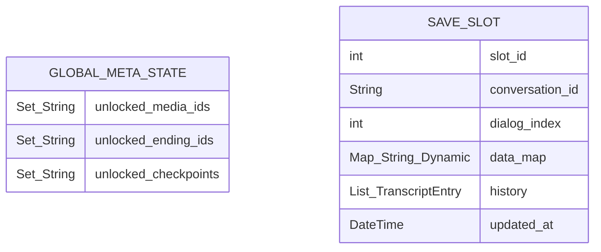

# Engine, State & Persistence Specification

This document specifies how `FsseEngine` manages runtime state, evaluates conditions and effects, interpolates variables, and persists progress across sessions.

---

## 1. Engine Contract (`FsseEngine`)

```dart
abstract class FsseEngine {
  /// Advance to the next eligible item, optionally applying [prevResult]
  /// from an INPUT or CHOICE item.
  Future<ItemType> next({ItemResult? prevResult});

  /// Return the current active item without advancing the index.
  Future<ItemType> get();

  /// Read the current playthrough's variable and stats store.
  Map<String, dynamic> getDataMap();

  /// Resolve the character Profile for a given [itemType].
  Profile? getProfile(ItemType itemType);
}
```

### Execution Lifecycle
1. **Initial Load**:
   - On the first call to `get()` or `next()`, the engine calls `EngineLoader.initialLoad()` to parse `profiles.json` and `index.json`.
   - Emits `EngineListener.onNewScene(conversation.scene)`.
2. **Result Handling (`_handleResult`)**:
   - When `next(prevResult: ...)` is called:
     - If `prevResult.variable` is non-null, writes `dataMap[prevResult.variable!] = prevResult.value`.
     - If `prevResult.effects` is non-empty, applies each state mutation in order.
     - If `prevResult.target` is non-null, loads `cvn_<target>.json` via `EngineLoader.loadConversation(target)`, resets `dialogIndex = 0`, and notifies `EngineListener.onNewScene`.
3. **Item Resolution & Condition Filtering**:
   - At `dialogIndex`, if the item defines a `condition` that evaluates to `false`, the engine automatically increments `dialogIndex` and evaluates the next item.
   - If the item is a `BRANCH` item, the engine evaluates `branches` in order, loads the matching `target` (or `fallback_target`), and resolves the first item of that new conversation.
   - Applies any item-level `effects`, clones the item with interpolated variables (`cloneWithData`), records the item in the active transcript history, and increments `dialogIndex`.

---

## 2. Typed State Store & Effects

The state store (`dataMap`) holds `Map<String, dynamic>` supporting `String`, `num` (`int`/`double`), and `bool` values.

### State Mutation (`Effect`)
Effects allow choices and dialogue items to modify relationship scores, counters, and flags:

| `op` | Target Type | Behavior |
| :--- | :--- | :--- |
| `"set"` | `String` \| `num` \| `bool` | Sets `dataMap[variable] = value`. |
| `"add"` | `num` | Adds `value` to `dataMap[variable]` (initializes to `0` if unset). |
| `"subtract"` | `num` | Subtracts `value` from `dataMap[variable]` (initializes to `0` if unset). |
| `"toggle"` | `bool` | Flips boolean value of `dataMap[variable]` (initializes to `false` if unset). |

---

## 3. Condition Evaluator

Conditions are boolean expressions evaluated against `dataMap`:
- **Comparison operators**: `==`, `!=`, `>`, `>=`, `<`, `<=`
- **Logical operators**: `&&`, `||`, `!`
- **Missing variables**: Unset numeric variables default to `0` in numeric comparisons; unset booleans default to `false`.

Examples:
- `"affection_luna >= 10"`
- `"miki_trust > 0 && saw_secret_photo == true"`
- `"PILL == 'Blue'"`

---

## 4. Variable Interpolation (`VariableReplacer`)

Any user-facing text field (`text`, `caption`, choice `text`, choice `value`) supports `{{VARIABLE_NAME}}` placeholders via `VariableReplacer`:
- Matches `RegExp(r"{{([a-zA-Z0-9_]+)}}")`.
- Converts the stored value in `dataMap[varName]` to a string (`toString()`).

---

## 5. Persistence & Save Architecture

Story games like *Salah Sambung 3* rely on two distinct persistence scopes: **Playthrough State** (scoped to a single run/save slot) and **Global Meta-State** (shared across all playthroughs).



### 5.1 Global Meta-State (Cross-Playthrough)
Persisted immediately whenever a player encounters a `MEDIA` item with an `unlock_id`, reaches an `ENDING` item, or enters a conversation marked `"checkpoint": true`:
- **Unlocked Media (`unlocked_media_ids`)**: Powers the Gallery (photos, CGs, voice notes, videos). Once unlocked, remains viewable even if the player starts a new game.
- **Unlocked Endings (`unlocked_ending_ids`)**: Tracks completion across all 20+ endings.
- **Unlocked Checkpoints (`unlocked_checkpoints`)**: Stores variable snapshots at major Day/Chapter boundaries so players can jump back to a specific Day to explore alternate branches.

### 5.2 Playthrough Save State (Auto-Save & Manual Slots)
- **Active Pointer**: `conversation_id` and `dialogIndex`.
- **Variables**: Current `dataMap`.
- **Chat / Backlog Transcript (`history`)**: Ordered list of delivered items in the current thread/chapter so the Messenger UI can render scrollable past messages upon app restart.
